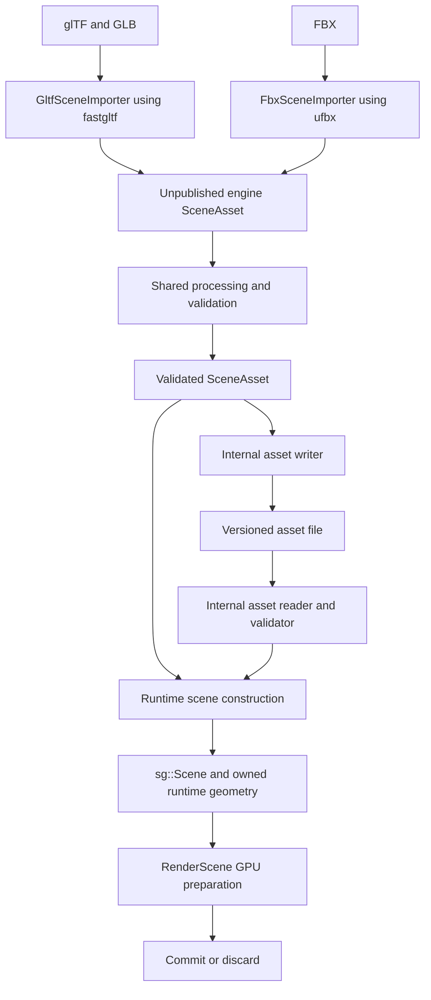

# Scene import and internal asset implementation plan

**Status:** Milestones 1–6 are implemented and verified on Windows in Debug and Release. macOS and manual native file-picker interaction remain unverified.
**Date:** 21 October 2026.

Support glTF, GLB and FBX through one engine import API. Convert each source
format into a complete, engine-owned CPU asset, process and validate that asset,
then construct the runtime scene and GPU resources through shared code. FBX is
the first additional format; retain fastgltf for glTF and use ufbx for FBX.

The first delivery boundary is glTF and FBX loading through the same internal
types in the editor and demo. The final milestone adds a versioned internal
asset file and cache so runtime loading can bypass source parsing.

## Scope and existing roadmaps

This work covers source import, internal asset ownership, shared processing,
runtime construction, format discovery, diagnostics and internal serialization.
A model is a scene asset with one or more roots and associated resources; it
does not need a separate loading pipeline.

Keep the rendering configuration and application boundaries in the
[ZenEditor rendering plan](ZenEditorRenderingPlan.md). Its requirement that
editor and runtime prepare scenes identically should use the shared loading
path introduced here. Implementing the player application is not required by
this plan.

The document persistence and composition proposals in
[ZenEditorImplementationPlan.md](ZenEditorImplementationPlan.md) remain
deferred. An imported asset cache is separate from an authored `.zenscene`
document containing instances and overrides. This work does not add hierarchy
editing, undo, project management, automatic reimport merges, source export,
USD, arbitrary shader graphs, or a dynamic plugin system.

Preserve the glTF feature coverage documented in
[GLTFSceneImport.md](GLTFSceneImport.md), including its explicit unsupported
features. FBX support has the feature boundaries described below; parser
support alone does not establish engine support.

## Implementation progress

The async loading prerequisite now lives in
[SceneLoader](../ZenCore/Include/AssetLib/SceneLoader.h). `LoadScene` returns an
owning CPU result; `SceneLoader::LoadAsync` returns a future and supports multiple
outstanding requests. Separate import and processing pools prevent imports from
occupying the workers they need to finish. Each request owns its parser,
diagnostics and unpublished scene.

The current glTF backend shares the processing pool for individual texture jobs
and primitive decoding, topology conversion, normal generation, UV remapping
and bounds calculation. A bounded window of primitive results limits temporary
geometry. Assembly follows source order to preserve indices and bindings.
Graph construction, animation conversion and initial deformation remain serial
within each import. They can overlap with work on other requested scenes.

The editor and sample share this CPU result and async service. Interactive model
switching retains the active scene while importing; GPU preparation, commit and
discard remain on the engine thread. Synchronous entry points remain available
for startup and tests. Service destruction drains its requests; dropping a future
does not interrupt parsing. GPU preparation can still stall a frame.

The immutable format registry dispatches `SceneImportRequest` through
`ISceneImporter` implementations. `ImportScene` returns an owning canonical
`SceneAsset`; `LoadScene` additionally invokes `BuildSceneRuntime`. Requests can
select a source scene, report structured failures and stages, and cancel
cooperatively. Parsers and codecs already executing finish before teardown.

The glTF reader now writes canonical nodes, meshes, materials, images, skins,
animations, cameras, lights and retained attributes directly. It has no scene
graph objects or independently owned geometry. Runtime construction resolves IDs,
creates independent mutable state and expands deformation geometry per instance.
Image pixels are decoded once per referenced image and shared immutably across
texture views and runtime instances. Codec and surface-normal processing are
shared implementation code. Parser and decoder headers are private dependencies.

Animation-pointer paths compile to typed properties during import, including
inactive targets and shared camera/light definitions. Runtime playback does not
interpret source paths or parse JSON. Source metadata belongs to the canonical
asset. `PrepareScenePlacement` makes normalization explicit; the editor and demo
request their existing normalized placement before constructing a renderer.

Fresh Debug/Release baseline builds, five test suites and all 339 glTF sample
variants are recorded under `build/scene-import/baseline`. Milestone 1 passed
those checks again under `build/scene-import/milestone1`. Milestone 2 results are
under `build/scene-import/milestone2`: five suites plus all 16 ray-query and 24
voxel-GI integration tests pass in Debug and Release, with no skipped integration
tests. All 339 glTF sample variants pass the current Release importer.
No loading speedup is claimed without comparable timing measurements.

Milestone 3 uses pinned ufbx v0.23.1 for static FBX, with the same internal asset,
runtime builder and processing pool. Per-instance material slots preserve shared
geometry. Fixtures cover ASCII/binary, pivots, geometric transforms, axes,
embedded/external images, named UVs and corner colors. The full five-suite set,
16 ray-query tests and 24 voxel-GI tests pass in Debug and Release. Native editor
tests render FBX through PBR and voxel GI in both RHI modes. All 339 glTF corpus
variants pass with unchanged imported structure counts relative to milestone 2.
Logs are under `build/scene-import/milestone3`; see [FBXSceneImport](FBXSceneImport.md)
for current mappings and diagnostic boundaries.

Milestone 4 adds linear/rigid skinning, all influences, in-between morphs and
source-evaluated animation baking with recorded tolerances and resource limits.
CPU fixtures compare transforms and deformed positions at keys and intermediate
times, including combined morph/skin, multiple clips and independent instances.
The five suites pass in Debug/Release; all 16 ray-query and 28 voxel-GI tests pass
without skips. Native tests cover initial deformed PBR/GI rendering and animated
GPU vertex uploads in all four submission modes. All 339 glTF variants pass with
unchanged structure counts. Logs are under `build/scene-import/milestone4`.

## Baseline before this refactor

| Area | Current behavior | Required change |
| --- | --- | --- |
| Import | The former `FastGLTFLoader` accepts glTF and GLB and builds `sg::Scene` directly | Keep format parsing behind an engine import API |
| Ownership | The loader owns vertices and indices; the scene owns components and supplemental asset data | Return one owning asset containing all imported data |
| Editor loading | [ParseScene](../ZenEditor/Model/Source/EditorScene.cpp) combines the scene and copied geometry in editor-owned `LoadedScene` | Move reusable asset loading and runtime construction into ZenCore |
| Other consumers | [SceneRendererDemo](../ZenSamples/VulkanRHIDemo/SceneRenderer/SceneRendererDemo.cpp) and [RenderObject](../ZenCore/Source/Graphics/RenderCore/V2/RenderObject.cpp) instantiate the glTF loader | Consume the same engine result |
| Runtime animation | The former `SceneAnimationPointer` resolves glTF paths and consults retained source JSON | Resolve source paths during import and evaluate typed engine targets |
| Placement | [RenderScene](../ZenCore/Source/Graphics/RenderCore/V2/RenderScene.cpp) calls `CenterAndNormalizeScene` during construction | Apply explicit placement before renderer construction |
| Discovery | The former `GLTFModelCatalog`, file filters and UI wording assume glTF | Derive supported extensions from the importer registry |
| Publication | [EditorViewport](../ZenEditor/Rendering/Source/EditorViewport.cpp) separates prepare, commit and discard | Preserve the transaction and GPU lifetime rules |

The existing `sg::Scene`, materials, animation evaluator and deformation code
are the runtime foundation. Extend and extract their reusable data and logic;
avoid introducing a second runtime scene graph.

## Target architecture



The processing stage mutates an unpublished `SceneAsset` in place. Publish only
the validated result. The initial design does not need separate persistent raw,
intermediate and processed scene schemas.

### Import and load contracts

| Proposed contract | Responsibility |
| --- | --- |
| `SceneImportRequest` | Source path, optional source scene selection, import settings and cancellation/progress context |
| `SceneImportResult` | Status, owning validated `SceneAsset`, dependency records and diagnostics |
| `SceneImporterRegistry` | Registered formats, extensions and import functions; shared by dispatch and discovery |
| `ImportScene` | Select a backend, translate source data, run shared processing, return a complete result |
| `BuildRuntimeScene` | Instantiate a validated asset into existing scene objects, geometry and runtime bindings |
| `LoadedScene` in ZenCore | Own the runtime scene, its geometry and any retained asset storage required by runtime references |
| `LoadScene` | Common application entry point; import a source or read an internal asset, then build the runtime result |

Use a small built-in registry with one descriptor per backend. Dispatch by
normalized extension and validate the selected format in its parser. Unsupported
formats return a named error. Adding a backend should require its implementation,
registration and tests, without changes to renderer or editor loading logic.
When internal files are added, the load service combines the source-format
descriptors with its built-in internal-file descriptor for Open and CLI support.
The internal reader does not masquerade as a source importer.

Keep public contracts free of fastgltf, ufbx, ImGui and native graphics types.
Parser headers belong in importer implementation files. Parser objects and
borrowed parser memory must be destroyed before a successful import result is
returned.

### Internal asset data

Use `asset::SceneAsset` as the canonical CPU representation. Extract suitable
records from the existing
[SceneGraph asset data](../ZenCore/Include/SceneGraph/SceneAsset.h), replacing
source-format enums and references where necessary. That existing structure
alone is insufficient: it does not own the complete hierarchy, resources and
index data.

| Data | Required representation and invariants |
| --- | --- |
| Nodes and roots | Asset-local IDs, names, parent/child references, exact local transforms, visibility and selected roots; preserve empty nodes and multiple roots |
| Meshes and primitives | Owned geometry streams and indices, topology, material slots, bounds and optional attributes; preserve points and lines alongside triangles |
| Instances | Node-to-mesh references, material-slot overrides, skin binding and default morph weights; shared geometry remains identifiable |
| Materials | Semantic engine factors, workflows and texture bindings; GPU packing remains derived runtime data |
| Images and samplers | Owned pixel/mip data, image format, sampling state, color interpretation and dependency metadata |
| UV and custom attributes | Compact engine slots plus source semantic/name metadata; preserve all currently supported glTF sets and custom values |
| Skins and morphs | Joint IDs, bind-space transforms, all supported influences, morph deltas and mappings through vertex splits |
| Animation | Named clips, seconds, interpolation, value streams and typed targets with explicit value dimensions |
| Cameras and lights | Engine camera/light definitions and node references, with documented units and axis conventions |
| Existing extensions | Engine data for implemented material variants, environment lighting and other supported behaviors |
| Source metadata | Format/importer identity, settings, source fingerprint, dependencies and optional opaque extras |

Asset references use indices or typed IDs, with explicit invalid values. Names
are display values. Asset-local IDs are not persistent document IDs and must not
be presented as stable across arbitrary source edits.

Use explicit source-to-asset and asset-to-runtime maps. A source camera, light
or mesh may have multiple runtime instances. Generated helper nodes also need
source mappings. References to valid objects outside a selected scene must have
defined inactive behavior rather than being confused with invalid references.

Preserve one authoritative bind-pose asset. Mutable animation state, posed
vertices, runtime material edits and preview placement belong to each runtime
instance. Share immutable storage where ownership is clear; do not add copies
of complete geometry at every pipeline stage.

### Processing and validation

Format adapters own accessor decoding, source topology interpretation, source
transform semantics, material mapping and animation conversion. Shared
processing owns engine invariants and reusable geometry/image preparation.

1. Validate sizes, references, graph structure, finite values and engine limits
   before allocation, indexing or narrowing counts.
2. Establish the canonical coordinate and texture conventions. Convert source
   data once; record the conversion in import metadata.
3. Prepare engine primitive/index streams and generate missing geometry
   attributes according to the existing shading contract. Preserve authored
   normals and tangents when valid.
4. Carry skin weights, morph deltas, UVs, colors and custom attributes through
   every split or remap. Vertex equality must include deformation data when
   deduplicating vertices; matching positions alone is insufficient.
5. Reuse image decoding, sampler deduplication, color/data interpretation,
   default-resource creation and material preparation across backends.
6. Resolve animation targets and validate sampler shapes and times.
7. Compute bind bounds and validate the initial pose. Runtime construction
   computes instance and posed bounds using the existing deformation logic.

Texture handling needs an explicit image-origin and UV convention. Consolidate
the glTF decoder and reusable parts of `TextureLoader` without changing existing
glTF orientation, color-space behavior or authored mip handling.

### Units and placement

The internal asset convention is right-handed, Y-up, with distances in meters
and animation times in seconds. Define camera/light axes, winding, tangent
handedness and UV orientation in the same contract and cover them with fixtures.
Retain source units and axes as metadata.

Separate conversion to these physical units from viewer placement:

- `PreservePlacement` keeps the asset's canonical origin and scale.
- `CenterAndNormalize` applies the existing viewer behavior to a runtime
  instance and records its center and scale.

Move normalization out of `RenderScene` into shared runtime preparation. The
editor and demo explicitly request their current normalization behavior during
migration; general loading defaults to preserving placement. Update camera,
light, material-distance, deformation and rendering-setting conversions
together so no quantity is scaled twice.

Loading the same asset into two runtime scenes must not modify the asset or
accumulate normalization. The renderer receives a prepared scene and owns GPU
resources, rather than source-format or placement policy.

### Animation independence

Replace runtime glTF JSON-pointer interpretation with typed property bindings.
A binding identifies its object kind, asset object, property, optional element
or component, and value type. Preserve quaternion interpolation and existing
step/linear/cubic-spline behavior.

The glTF importer resolves `KHR_animation_pointer` while the source document is
available, including required existence checks. Runtime construction resolves
bindings to active instances. Playback validates all channel samples before
publishing a pose, as it does today.

Retained source JSON or FBX metadata may support inspection, but playback,
deformation and rendering must work after that metadata is discarded. FBX
property animation targets the same engine bindings.

### Errors and publication

Return status codes and structured diagnostics containing severity, source path,
object context and a useful explanation. Distinguish invalid data, unsupported
features, missing dependencies, cancellation and resource-limit failures.
Warnings describe explicit approximations; do not report unsupported content as
fully supported.

Keep import CPU-only and usable without a graphics device. Top-level glTF
requests now run concurrently with isolated parser and output state. Processing
uses a separate bounded worker pool, with immutable source reads and ordered
result assembly. Verify backend and decoder thread safety before adding another
format to this path. Progress may report stages when byte-level progress is
unavailable; it must not invent percentages.

Build candidates off the active scene. On failure or cancellation, release
candidate data and retain the active scene, selection and rendering settings.
GPU admission, upload completion, publication and retirement remain in the
existing render-thread transaction. A cancelled worker must finish or stop
before its data and callbacks are destroyed.

## FBX conversion

Use a pinned ufbx revision through the repository's existing dependency
declaration and checksum mechanism. Keep its license notice and compile it as
an importer dependency. Its documented scope includes binary/ASCII FBX, mesh,
material, skin and animation utilities; engine acceptance remains fixture-based.
See the [ufbx project](https://github.com/ufbx/ufbx/blob/main/README.md).

| Feature | Initial engine contract |
| --- | --- |
| Static geometry | Triangulated polygon meshes, normals/tangents, colors, UV sets and material parts |
| Hierarchy | Empty nodes, shared meshes, visibility, converted transforms and per-instance material bindings |
| Materials | Map supported ufbx material properties into existing engine workflows; document approximations and unsupported texture/procedural combinations |
| Textures | External and embedded images using shared decoding, with source-relative resolution and dependency tracking |
| Cameras and lights | Map representable perspective/orthographic cameras and punctual lights; report unsupported modes or units explicitly |
| Deformation | Rigid and linear skinning, morph targets, morph-before-skin ordering and independent instance state |
| Animation | Import animation stacks as clips, bake supported source behavior into engine tracks, retain clip names and normalize clip start time |
| Unsupported behavior | Diagnose unsupported skinning modes, deformation order, geometry caches, procedural geometry, constraints or material graphs; do not silently flatten them into a claim of full support |

Use ufbx's transform conversion and helper-node facilities to handle pivots,
geometry-only transforms and unusual inheritance. Choose one explicit import
configuration and test it against world transforms from ufbx. Preserve shared
geometry and instance material overrides through conversion.
[Node conversion reference](https://ufbx.github.io/elements/nodes/)

Triangulate polygon corners and resolve attributes using their own indices.
Preserve a mapping from generated vertices to source control points for skin
and morph data. Group primitives by material slot; resolve each instance's slot
bindings separately.
[Mesh reference](https://ufbx.github.io/elements/meshes/)

Bake supported FBX animation through the evaluator instead of copying raw Euler
or weighted cubic curves into the glTF sampler layout. Store the bake sampling
settings and error tolerances in import settings. Validate at key times and
between keys, including clip endpoints and discontinuities.
[Animation reference](https://ufbx.github.io/elements/animation/)

Validate bind transforms in the converted geometry space. Preserve all
influences supported by the engine rather than imposing a new four-weight
limit. Handle zero/invalid weights explicitly. Convert in-between blend shapes
into equivalent engine weight tracks or reject that feature with a diagnostic;
keeping only the final shape is insufficient.
[Deformer reference](https://ufbx.github.io/elements/deformers/)

## Implementation milestones

Complete milestones in order. Each milestone must build and satisfy its exit
checks before the next one changes more behavior.

### Milestone 1 Establish the common API and baseline

- [x] Capture fresh glTF import, animation and rendering baselines using rebuilt
  targets and the available sample corpus.
- [x] Define asset ownership, reference IDs, units, import settings and
  diagnostics; add a small format registry and generic loading entry point.
- [x] Move the reusable `LoadedScene` result to ZenCore and migrate editor,
  demo and `RenderObject` to the generic entry point.
- [x] Temporarily adapt the existing glTF loader behind that entry point.
  Keep this adapter internal and scheduled for removal in milestone 2.

**Exit:** Existing glTF/GLB workflows behave as before. Application loading code
does not instantiate `FastGLTFLoader`. Failure retains the active result.
The generic API can be used without editor or UI dependencies.

### Milestone 2 Produce complete internal assets from glTF

- [x] Extract engine asset records and convert glTF directly into `SceneAsset`.
  Move suitable existing payload types instead of maintaining duplicate schemas.
- [x] Extract shared processing, image handling and runtime construction from
  the loader. Preserve source-to-generated vertex mappings.
- [x] Convert pointer animation into typed bindings, including inactive targets
  and definitions with multiple instances.
- [x] Move normalization into explicit runtime preparation and retain existing
  editor/demo behavior through the placement option.
- [x] Build runtime component/material bindings from asset IDs. Keep packed
  `MaterialData` and flattened runtime buffers as derived data.
- [x] Remove the temporary loader adapter and independent loader geometry
  ownership after consumers and tests have migrated.

**Exit:** All existing glTF capabilities and negative-input behavior pass.
Destroying the parser and removing optional source metadata does not affect
playback. Two runtime instances can animate independently. Creating either
runtime instance leaves the canonical asset unchanged.

### Milestone 3 Import FBX static scenes

- [x] Add the pinned ufbx dependency and implement `FbxSceneImporter`.
- [x] Convert hierarchy, coordinates, geometric transforms and instances.
- [x] Convert corner attributes and material parts into engine geometry.
- [x] Map materials, external/embedded textures, cameras and lights into the
  shared asset contract.
- [x] Report unsupported features and missing resources through common
  diagnostics; validate imports before returning them.
- [x] Add small documented binary and ASCII FBX fixtures, including their
  provenance and redistribution terms.

**Exit:** Static fixtures render through the existing PBR and voxel-GI paths.
Equivalent FBX and glTF fixtures agree on canonical geometry, bounds, placement
and explicitly matched material behavior. Parser destruction leaves no borrowed
memory in the result.

### Milestone 4 Import FBX deformation and animation

- [x] Map skeleton references, bind transforms and influence streams.
- [x] Convert morph channels and supported in-between behavior.
- [x] Bake animation stacks and supported properties into common engine tracks.
- [x] Validate generated helper nodes and bindings over the whole clip.
- [x] Preserve per-instance material, pose and morph state; reuse shared
  immutable mesh data.
- [x] Reject unsupported skinning or deformation behavior with named diagnostics.

**Exit:** Engine world transforms and deformed vertices agree with the source
evaluator within declared tolerances at keys and intermediate times. Combined
morph/skin fixtures, mirrored transforms, nonuniform scales and independent
instances pass. Playback requires no ufbx object or evaluator.

### Milestone 5 Complete discovery and application integration

- [x] Generalize `GLTFModelCatalog` and its public entry type. Generate catalog
  filtering and file-picker extensions from registered source formats.
- [x] Update editor Open/Open Recent, fallback path entry, demo selection,
  command-line help and runtime UI wording for supported scene files.
- [x] Rename format-specific light origins such as `eGLTF` to imported-scene
  semantics. Preserve any existing serialized meanings through explicit
  migration where applicable.
- [x] Retain compatibility with existing configured glTF model paths while
  exposing general source paths; avoid changing unrelated configuration keys.
- [x] Surface import warnings and unsupported-feature errors in the current
  load/error UI. Integrate cancellation with the existing transaction.
- [x] Remove obsolete parser includes and format branches outside import code.

**Exit:** Switch glTF to FBX to GLB repeatedly in editor and demo, including
invalid and cancelled imports. Previous scenes remain usable on failure.
Discovery, file dialogs and actual dispatch agree on supported formats.

Verification: all eleven affected targets built in Debug and Release. The six
CommonTest, RenderCoreTest, EditorModelTest, EditorRenderingTest,
SceneModelSwitchTest and RuntimeUIIntegrationTest suites passed in both builds.
Hidden editor startup with FBX rendered PBR (Debug) and GI (Release) captures
under Vulkan validation. Mixed-format switching and cancellation are covered in
both applications. Logs and captures: `build/scene-import/milestone5/`.
An intermittent native test failure was traced to the injected RivaTuner
swapchain hook calling freed executable memory; the final runs passed after
the user exited RivaTuner. Temporary crash instrumentation was removed.

### Milestone 6 Add the internal asset file and cache

- [x] Define a versioned CPU asset file, provisionally `.zenasset`, with a magic
  value, schema version, fixed-width fields, explicit byte order and bounded
  sections for metadata, records and bulk data.
- [x] Serialize semantic asset records field by field. Exclude pointers, C++
  object layouts, RTTI, GPU handles, mutable playback state and preview
  normalization. Do not use `sizeof` dumps as the file contract.
- [x] Add a reader that validates lengths, arithmetic overflow, references,
  allocation budgets and schema compatibility before runtime construction.
- [x] Route `.zenasset` through common load dispatch and include it in accepted
  Open/CLI formats, keeping source-import selection distinct.
- [x] Make files self-contained for supported runtime payloads, including
  textures and animations. Keep source metadata optional.
- [x] Key automatic caches by source content, transitive dependency content,
  import settings, importer/processor versions, schema version and a build
  fingerprint of the import sources.
- [x] Write through a temporary file and atomic replacement. Interrupted
  writes must leave the previous valid file intact.
- [x] On a stale or corrupt automatic cache, rebuild from available source.
  Explicit internal-file loading reports incompatibility or corruption; it
  must not require an unavailable source parser.

**Exit:** Source import and internal-file load produce equivalent runtime
behavior. An internal file loads with source files unavailable and no source
parser invocation. Source/texture/settings changes invalidate automatic caches.
Truncated files, bad counts, invalid references and failed writes are handled
without publishing invalid data.

Verification: all eleven affected targets built in Debug and Release. The six
CommonTest, RenderCoreTest, EditorModelTest, EditorRenderingTest,
SceneModelSwitchTest and RuntimeUIIntegrationTest suites passed in both builds,
as did all 16 ray-query and 28 voxel-GI integration tests per build. The glTF
source corpus passed 339/339 with caching disabled. Internal-file tests cover
source-free textured and animated loading, extended material/UV/mip/environment
payloads, malformed semantic references with valid checksums, bounds and budgets,
source/texture/buffer/settings/version invalidation, concurrent mixed requests,
failed replacements and cancellation after bulk bytes have been written.

Both Intel main Sponza FBX axis variants passed source import. A complete Y-up
internal file (11,036,322,336 bytes) reproduced all source runtime counts and
rendered in PBR and GI under Vulkan validation. The source/internal PBR captures
were pixel-identical. These default-camera images frame an exterior wall; they
are not interior-GI quality references. With the same Release CPU harness,
source import/verification took 38.00 seconds and internal load/verification
44.51 seconds with the first cache implementation.

A follow-up review pass made the cache fast enough to enable by default. Caches
are published on a background writer after the load returns, live in the
engine tree's `Cache/SceneAssets`, are keyed by a build-time fingerprint of the
import sources, validate inputs by XXH64 content hashes (size changes reject
without reading), and are evicted least-recently-used beyond a budget. Schema 2
moves bulk arrays as single blocks and keeps the source document out of the
metadata section. Hashing, validation and image decoding run in an optimized
kernel library in every configuration. Intel main Sponza glTF now loads cold in
2.4 s (Release) and 5.5 s (Debug), and from the cache in about 1.2 s and 1.9 s;
see [SceneAssetFormat](SceneAssetFormat.md) for the measurements.

Logs: `build/scene-import/milestone6/`; large-scene evidence:
`build/scene-import/milestone6/sponza/` and
`build/scene-import/sponza-validation/`. Three stale generated Debug compiler
PDBs were regenerated. A cancellation-test observation issue caused by cached
Windows directory sizes was fixed by reading the open file's end through a
separate handle. Final runs passed without skips in the ray-query/voxel-GI
suites. No source model files were changed.

The file contract, API controls and cache locations are documented in
[SceneAssetFormat.md](SceneAssetFormat.md). Windows native loading and generated
file-picker filters are covered; manual native-picker interaction and macOS
native/GUI verification require follow-up on the corresponding platform.

## Expected code organization

Names below describe responsibilities; keep helpers together where splitting
them would add one-call forwarding layers.

| Location | Responsibility |
| --- | --- |
| `ZenCore/Include/AssetLib/SceneAsset.h` | Canonical owning CPU records and IDs |
| `ZenCore/Include/AssetLib/SceneImporter.h` | Public requests, results, diagnostics, format descriptors and import API |
| `ZenCore/Source/AssetLib/GltfAssetReader.cpp` | glTF parser and source-to-engine conversion |
| `ZenCore/Source/AssetLib/FbxSceneImporter.cpp` | FBX parser and source-to-engine conversion |
| `ZenCore/Source/AssetLib/SceneAssetValidation.cpp` | Shared canonical data validation |
| `ZenCore/Include/AssetLib/SceneLoader.h` and its source | Runtime result ownership, asset loading and shared runtime construction |
| `ZenCore/Source/AssetLib/SceneRuntimeBuilder.cpp` | Canonical asset to independent runtime instances |
| `ZenCore/Source/AssetLib/SceneAssetIO.cpp` | Versioned internal file read/write |
| `ZenCore/Source/AssetLib/SceneAssetCache.cpp` | Content validation, background publication and eviction of automatic caches |
| Existing scene graph animation and material files | Runtime evaluation, instance state and GPU-data publication |
| Existing texture loader and model catalog files | Shared decoding and format-neutral discovery |
| `External/CMakeLists.txt` and `ZenCore/CMakeLists.txt` | Pinned dependency and private importer integration |
| `ZenSamples/CommonTest` and `ZenEditor/Tests` | Import, runtime and transaction regressions |

Use `HeapVector`, `HashMap` and suitable existing engine utilities. Follow the
global C++ rules: one final return, explicit types except iterators, short
necessary lambdas, no thrown exceptions, shared logic and project formatting.
Keep runtime GPU-limit checks even when CPU asset validation has succeeded.

## Verification and completion criteria

| Area | Required cases |
| --- | --- |
| Existing glTF behavior | Current corpus, compression, UV/color interpretation, materials, variants, cameras/lights, skins/morphs and pointer animation |
| Transform conversion | Meters/centimeters, Y/Z-up, mirrored/nonuniform transforms, pivots, geometry-only transforms and inheritance |
| Geometry | N-gons, UV seams, hard edges, multiple UV sets/materials, missing attributes, empty scenes and invalid indices |
| Ownership and instances | Parser destruction, optional metadata removal, shared meshes with different materials, two independently animated runtime instances |
| Deformation | Multiple influences, bind pose, morph plus skin, in-between shapes, clip boundaries and unsupported deformation diagnostics |
| Failure behavior | Missing/corrupt textures, truncated sources, unsupported features, cancellation, capacity failure and recovery on the next load |
| Internal files | Round-trip equivalence, source-free load, version rejection, malformed sections, dependency invalidation and atomic write failure |
| Applications | Editor/demo format switching, registry-driven discovery, load progress and intact active-scene resources after failure |

Use the existing unit suites and corpus tools as the baseline. Add focused
regressions for observable behavior and ownership contracts. Extend or replace
the corpus harness with a generic scene-import harness while preserving its
glTF checks and report semantics.

Example Windows checks from an MSVC development environment configured with
testing, editor and runtime UI targets enabled:

```powershell
cmake --build --preset x64-windows-msvc-debug --target CommonTest RenderCoreTest EditorModelTest EditorRenderingTest SceneModelSwitchTest GLTFCorpusImport scene_renderer_demo zen_editor --parallel 8
ctest --test-dir build/x64-windows-msvc-debug --output-on-failure -R '^(CommonTest|RenderCoreTest|EditorModelTest|EditorRenderingTest|SceneModelSwitchTest)$'
python tools/verify_gltf_corpus.py --assets E:/Dev/glTF-Sample-Assets --importer build/x64-windows-msvc-debug/bin/GLTFCorpusImport.exe --report build/scene-import-gltf-results.json --jobs 2
```

Use the corpus path available on the validation machine. Run the existing glTF
rendering, material, camera and physical-unit probes when their contracts change;
run configuration-mutating render scripts sequentially. Add FBX integration
captures for static and animated fixtures under Vulkan validation. Record
unsupported cases and numeric/image tolerances explicitly.

Build and run relevant checks in Debug and Release. Validate native loading and
file dialogs on Windows and macOS, consistent with the editor platform scope.
CPU tests do not establish GPU rendering or platform UI correctness.

The work is complete when both source backends and internal asset files use
the common runtime construction path; source parsers do not participate in
playback; existing glTF behavior is preserved; the declared FBX feature set
passes; and failed import, load or GPU preparation preserves the active scene.
