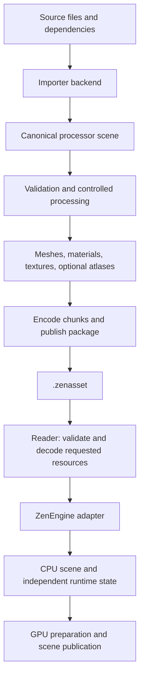

# Standalone ZenAssetProcessor implementation plan

**Status:** Processor implementation is complete for the verified Windows configuration; current development integration passes Debug/Release and focused Vulkan checks. Broader rendering and release gates remain open.
**Updated:** 25 October 2026.
**Library location:** `E:/Dev/ZenAssetProcessor`, a separate Git repository and standalone CMake project.
**Engine integration:** ZenEngine uses the live sibling checkout by default through `External/ZenAssetProcessor.cmake`. A source-path override or installed package remains supported.
**Development policy:** Keep ZenAssetProcessor unpinned while it is under active development. Release publication and version-pinning policy are deferred until a release is requested.

Build a reusable asset processor that imports source models, converts them to a
defined scene/material representation, optimizes their resources, and writes
compressed `.zenasset` packages. ZenEngine reads those packages and converts
their records into its internal scene and rendering representation.

The first delivery preserves the current glTF/GLB/FBX feature set through the
standalone library. Compression, optional atlases, and additional formats follow
as separately verifiable milestones. The standalone repository now exists at the
location above. The v3 schema is still under development and is not a released
compatibility contract.

### Execution status

The [25 October integration checkpoint](ZenAssetProcessorIntegrationVerification.md)
consumes the completed processor from the unpinned sibling checkout. Debug and
Release editors build; each configuration passes 140 asset and 72 editor CPU
checks with one directory-symlink privilege skip. All 28 focused Vulkan checks
pass on the RTX 5080. A tools-disabled runtime build and actual package-loader
link command confirm the reader/decoder boundary. Asset tests remain owned by
ZenAssetProcessor; the historical milestone evidence below retains its original
scope.

The [baseline verification report](ZenAssetProcessorM0Verification.md) records
the frozen source snapshot, commands, corpus, v2 goldens, measurements, and
existing failures. The implementation currently has these verified results:

- A fresh standalone Processor build fetched its own pinned dependencies,
  installed successfully, and passed all six registered tests. A separate
  installed-package consumer imported an authored triangle and decoded its PNG.
  A fresh reader-only build/install and consumer passed without fetching source
  importers or encoders. Relocated-prefix consumption and installed-engine tests
  also passed. The installed M3 runtime loaded nine legacy and four v3 packages
  without source importer or encoder links.
- The engine source path uses `ZenEngineAssetTools` and the independent processor.
  All 339 glTF runtime structure records and all 22 FBX outcomes/counters match
  the M0 corpus. Final M2 Debug and Release engine tests each passed 162 cases
  with one existing privilege skip; the editor model suites each passed 41 cases.
  See [M2 verification](ZenAssetProcessorM2Verification.md). The subsequent
  seven-scene render gate also passed after correcting extracted vector division
  to preserve the original float rounding.
- A fresh runtime-only engine loaded all nine preserved source-free v2 golden
  packages. The v3 raw scene reader/writer and CLI round trips pass focused
  standalone tests, including cancellation, corruption, allocation limits,
  Unicode paths, and replacement while an older package remains open.
- All 360 accepted glTF/FBX scenes passed direct public-field comparisons after
  v3 serialization, plus deterministic rewrites. A bounded libFuzzer/ASan run
  exercised 14,307 inputs in 121 seconds without a sanitizer or invariant
  failure; both instrumented reader test suites passed. This finite run does
  not establish exhaustive malformed-input safety.
- M3 engine cache publication, metadata lookup and explicit v3 loading are
  integrated. Debug and Release engine tests each passed 164 cases with one
  privilege skip, and both editor model suites passed 41 cases. All seven
  direct-source/raw-v3 render pairs and frozen M0 comparisons are pixel-identical.
  See [M3 verification](ZenAssetProcessorM3Verification.md) for evidence and limits.
- M4 per-chunk Zstandard is implemented as an opt-in, with bounded static codec
  workspaces, raw fallback, metadata version compatibility, and source-free
  decoding. All seven source/compressed-v3 render pairs and frozen comparisons
  are pixel-identical. Meshoptimizer vertex/index sequence encoding also passes
  all seven exact render comparisons, with storage/CPU measurements recorded.
  Geometry cooking passes focused CPU tests and the full 360-source remapping
  corpus. Seven optional quantization cases pass independent numerical bounds;
  their reference captures are exact and lossy image differences are recorded.
  See [M4 verification](ZenAssetProcessorM4Verification.md) and
  [quantization evidence](ZenAssetProcessorM4QuantizationVerification.md).
  The first BC7 slice passes 11 independent image audits and 15 exact raster
  reference pairs. GI repeatability and desktop visual acceptance remain open;
  see [M5 evidence](ZenAssetProcessorM5VisualVerification.md). M6 atlases and
  remaining compression gates remain in progress. M7 batch/editor integration
  passes the [installed-consumer and equality checks](ZenAssetProcessorM7BatchVerification.md).
- A current fresh Windows Release engine build consumes a relocated installed
  Reader package with the source override and asset tools disabled. Eight
  legacy/current packages load, eight native upload runs pass, and two invalid
  inputs fail as expected. See the [installed-runtime checkpoint](ZenAssetProcessorInstalledRuntimeVerification.md)
  for link evidence, the local runtime capsule and the release limits. The
  subsequent [Reader source checkpoint](ZenAssetProcessorReaderSourceVerification.md)
  removes unused encoder downloads through a reviewed decoder subset. Fresh
  Debug/Release Reader tests, installed consumers and both full Processor
  Debug/Release suites pass with that boundary.

Measured M0 evidence includes package size, CPU memory, source/warm-load timing,
publication timing, and whole-application GPU allocation. The subsequent
[isolated upload benchmark](ZenAssetProcessorM5UploadMeasurements.md) measures
native texture/canonical geometry allocations, explicit staging buffers and
graphics-queue GPU upload intervals. The later
[production staging campaign](ZenAssetProcessorProductionStagingMeasurements.md)
measures pool occupancy, native upload-buffer lifetime peaks and CPU publication
across 160 real scene publications in inline/threaded RHI modes, with accepted
transfer work confirmed. The subsequent
[production GPU timing campaign](ZenAssetProcessorProductionGPUTimings.md)
measures 2,420 upload-node intervals across another 160 publications on the
dedicated transfer queue, in both RHI modes. These four workloads now have
direct production GPU timing; overlap/frame benefits and broader workload/device
coverage remain open. Neither CPU timing nor the isolated harness establishes them.
Public byte limits bound specified record/payload storage; they do not claim a
bound on all parser-private allocations or process RSS. These limitations must
remain explicit at the relevant acceptance gates.

## 1. Scope and decisions

- Own the processor in a separate repository, with independent builds, tests,
  versioning, and releases. Its build must work without a ZenEngine checkout.
- Ship a processor library, a `zenassetc` command-line tool, shared format
  definitions, and a small runtime reader. Source parser and encoder dependencies
  belong to the processor/tool targets.
- Keep ZenEngine scene construction, mutable pose, renderer resource ownership,
  preview placement, and GPU publication in ZenEngine.
- Preserve scene hierarchy, instancing, animation, skinning, morphs, cameras,
  lights, variants, and supported material features alongside meshes and images.
- Make texture atlasing optional and conservative. Standalone textures remain
  valid resources in every package profile.
- Introduce a new chunked schema, provisionally version 3. Retain explicit v2
  file loading during migration; rebuild automatic caches through tooling.
- Start with a lossless reference profile and a desktop Vulkan profile. Portable
  texture transcoding and additional platform profiles can follow the desktop
  delivery without changing the package's resource model.
- Keep source processing available in the editor and source-enabled samples.
  A runtime-only build loads prepared packages without source parsers or encoders.

Authored scene documents, arbitrary shader-graph conversion, source-format
export, dynamic importer DLLs, virtual texturing, GPU mesh decompression, and
renderer-specific acceleration structures are outside the initial scope.
The package can support future selective loading without requiring a complete
streaming system in the first release.

## 2. Existing implementation and extraction map

The existing [scene asset format](SceneAssetFormat.md) and
[scene import plan](SceneImportImplementationPlan.md) describe the baseline.
Preserve the feature contracts in [GLTFSceneImport](GLTFSceneImport.md) and
[FBXSceneImport](FBXSceneImport.md); parser support alone does not establish
end-to-end engine support.

This extraction map records the starting responsibilities. Links for shared
processing and automatic caching now point to their migrated implementations.

| Current area | Planned ownership and work |
| --- | --- |
| [SceneAsset and related records](../ZenCore/Include/AssetLib/SceneAsset.h) | Use their semantics to define independent processor records. Keep any engine-specific canonical representation behind the adapter. |
| [Source dispatch](../ZenCore/Source/AssetLib/SceneImporter.cpp), glTF/FBX conversion, image decoding | Move to processor backends; parser types stay private. |
| [Shared processing](../../ZenAssetProcessor/src/Processing/SceneAssetProcessing.cpp) | Preserve current cleanup and validation, then add separately controlled optimization passes. |
| [Serialization](../ZenCore/Source/AssetLib/SceneAssetIO.cpp) and [validation](../ZenCore/Source/AssetLib/SceneAssetValidation.cpp) | Reuse applicable contracts and algorithms in shared format/reader code; specify the new wire schema independently of C++ layouts. |
| [Automatic cache](../AssetTools/Source/SceneAssetCache.cpp) | Move source processing and publication policy to tooling; retain explicit package loading in runtime code. |
| [Runtime builder](../ZenCore/Source/AssetLib/SceneRuntimeBuilder.cpp) | Remains in ZenEngine and consumes adapted package data. |
| [Texture upload](../ZenCore/Source/Graphics/RenderCore/V2/TextureManager.cpp) | Extend for compressed blocks, complete mip chains, and device-format checks. |
| [Editor previews](../ZenEditor/Model/Source/SceneAssets.cpp) | Add a defined thumbnail/decode path for compressed images. |
| [Dependency integration](../External/ZenAssetProcessor.cmake) | Consume the independent processor through its CMake targets, using the live sibling checkout during development; retain shared engine dependencies. |

Current extraction constraints:

- Public asset types depend on engine math, `HeapVector`, `SmallVector`, and
  `SharedPtr`; `SceneImportContext` exposes the engine thread pool.
- The existing `zen_asset_kernels` target is already independently compiled for
  fast hashing/decoding in Debug, but is not the complete asset processor.
- Scene image validation currently accepts RGBA8 and checks pixel-sized mip
  payloads. Existing Basis/KTX2 input support decodes into RGBA pixels.
- Editor texture thumbnails sample RGBA8 bytes directly. Merely changing the
  file compression would not provide compressed GPU texture support.
- Existing source backends preserve substantially more than static mesh data.
  Extraction must retain those semantics before introducing lossy processing.

## 3. Repository and dependency boundary

Proposed layout:

```text
E:/Dev/ZenAssetProcessor/
  CMakeLists.txt
  CMakePresets.json
  cmake/                    # Packaging and pinned dependencies
  include/ZenAsset/
    Format/                 # IDs, records, layouts, status, version contract
    Processor/              # Import and cook API
    Reader/                 # Package and resource access API
  src/
    Format/
    Importers/Gltf/
    Importers/Fbx/
    Processing/
    Writer/
    Reader/
  tools/zenassetc/
  tests/                    # Small distributable fixtures and corpus manifests
  docs/

E:/Dev/ZenEngine/
  External/ZenAssetProcessor.cmake # Live sibling checkout or installed package
  ZenCore/.../AssetLib/      # Runtime adapter and scene construction
  .../AssetTools/           # Source-enabled integration target; location finalized in M1
```

| Target | Consumers | Dependencies |
| --- | --- | --- |
| `ZenAsset::Format` | Reader and processor | Minimal data/status utilities; no engine or graphics API dependency |
| `ZenAsset::Reader` | Runtime and tools | Format, required decompression libraries, optional texture transcoder |
| `ZenAsset::Processor` | Editor integration and CLI | Format, importers, processing passes, encoders and writer; reader where needed for verification |
| `zenassetc` | Developers and asset builds | Processor and reader |
| `ZenEngineAssetTools` | Editor, import tests, source-enabled demos | Processor plus ZenEngine runtime adapter |
| `ZenCore` runtime adapter | Engine applications | Reader plus engine scene/rendering code |

Use C++20 and static libraries initially. Public data uses fixed-width fields,
explicit resource IDs, small independent math records, and non-owning views.
An owning package/processed-asset object defines view lifetimes. Keep parser
objects, engine containers, compiler-specific object dumps, and Vulkan enum
values out of the wire contract. A stable binary DLL ABI is not a first-release
requirement.

Keep allocation ownership explicit; support bounded allocations and structured
diagnostics. Use a small execution interface or processor-owned workers instead
of exposing `zen::ThreadPool`. Cap simultaneous jobs by memory as well as worker
count, and preserve cooperative cancellation. Existing parser/codec calls may
finish before cancellation can be observed.

ZenEngine integration continues using `HeapVector` and its existing ownership
types. Standalone internals use suitable containers without pulling the engine
memory subsystem into the library. Reuse a suitable standalone container if
one exists; do not maintain a copied engine container implementation solely for
this extraction.

For dependency consumption:

- Export/install the library's CMake targets and package version information.
- Use the live sibling checkout without a release or commit pin during active
  development. Revisit release distribution only when requested; do not invent
  a remote URL before the repository is hosted.
- Default the development source-directory option to `../ZenAssetProcessor`
  when present, which resolves to `E:/Dev/ZenAssetProcessor` in this workspace.
  Allow another checkout path or an explicit empty value for an installed package;
  do not hard-code the machine's drive layout.
- Support existing dependency targets to avoid duplicate GLM, codec, or logging
  builds. Keep dependency configuration scoped to the standalone project.
- Ensure configuring with processor/tools disabled does not download or build
  source importers or encoders. Demonstrate this from a fresh build directory.

## 4. Processing and runtime flow



The processor's canonical scene retains rich source semantics. Its cooked
resource representation describes optimized storage. ZenEngine's runtime scene
retains engine ownership and mutable state. Keep these boundaries explicit;
share definitions where meanings match instead of duplicating entire structures.

Source-enabled tools perform `import -> process -> write/read -> adapt` in
parity tests. Production editor loading may adapt a freshly processed result
while publishing its package asynchronously, provided both paths consume the
same cooked representation and have equivalent results.

Move source dispatch and the source-enabled async loading service to the tool
integration target. Update editor/demo call sites there. Keep package loading
and runtime construction available in ZenCore. A temporary `ImportScene`
compatibility facade may live in the tool target while callers migrate.

Runtime work remains explicit: resolve IDs, construct scene components, create
independent pose/material state, prepare deformation geometry, compute bounds,
and upload resources. Preserve the current prepare/commit/discard behavior so
failed or cancelled loads leave the previous scene active. Preview normalization
is still an engine operation.

Initially decode mesh data into the engine's existing CPU geometry layouts to
retain deformation and ray-query behavior. Avoid unnecessary intermediate
copies where lifetimes permit. GPU-packed vertex consumption is a later
optimization; mesh file compression alone does not imply reduced runtime
vertex memory. Preserve GPU-compressed texture blocks through upload.

## 5. Package contract and compatibility

Keep `.zenasset` as the package extension. Define the new schema before freezing
its writer. Use one self-contained file for the initial release, with logical
resources that can later be split or deduplicated across packages.

| Resource | Required contents |
| --- | --- |
| Scene | Roots, nodes, transforms including affine/base matrices, instances, visibility flags, resource references, per-instance overrides |
| Mesh | Primitive topology, vertex layout/streams, indices, submesh material slots, bounds, skin/morph bindings, optional LOD descriptors |
| Material | Supported PBR features, alpha mode, double-sided state, factors, texture/sampler bindings, UV-set selection and transforms |
| Texture | Image dimensions, color space, encoding, mip/layer/face descriptors, payloads, optional preview and atlas metadata |
| Deformation/animation | Skeletons, inverse bind matrices, influences, morph deltas/defaults, clips, typed targets and interpolation data |
| Other scene data | Cameras, punctual lights, HDR environment data, variants, supported custom attributes |
| Build information | Processor/dependency identities, profile/settings, dependency hashes, diagnostics, optional provenance |

Use an explicit little-endian header and resource/chunk directory. Entries
include stable resource ID, type/version, flags, file offset, encoded and decoded
lengths, alignment, semantic encoding, transport codec, and integrity data.
Texture block encoding and outer compression are separate fields. Protect the
header/directory as well as payload chunks against corruption.

The reader validates arithmetic, file bounds, overlaps, alignment, duplicate IDs,
required references, supported versions/codecs, and decoded-memory budgets
before allocating or exposing resources. Bound individual chunks, aggregate
allocations, decompression output, and runtime geometry expansion. Verify the
semantic resource graph before constructing a scene. Unknown optional chunks
may be skipped; unknown required features fail with a specific diagnostic.

Version the container, resource schemas, processor behavior, and codec bitstreams
explicitly. Define compatibility rules and retain golden fixtures. Do not bind
the format to `sizeof(Vertex)`, allocator layout, addresses, or a GPU driver.
Reader and writer share one schema implementation.

Migration rules:

- Keep the current v2 reader in ZenEngine as a compatibility path initially.
  New processing writes v3 once its contract is accepted.
- During M2, the tool integration facade preserves existing v2 automatic-cache
  lookup, dependency checks, asynchronous publication, cancellation, and eviction
  around the adapted canonical asset. Move source policy out of ZenCore without
  removing these behaviors. Include the standalone processor identity in cache
  invalidation so legacy fingerprints cannot accept changed processing results.
- During M3, switch that facade to v3 cache packages and the shared reader/writer,
  retaining the same correctness and responsiveness guarantees. M7 adds batch
  manifest orchestration; it is not the first delivery of working cache behavior.
- Route by the stored version; an unsupported explicit package fails clearly
  without silently consulting its source.
- Old automatic caches can be rebuilt from source by tools. A runtime build
  does not require the source tree or cache metadata.
- Offer explicit recooking through `zenassetc`. Conversion of a source-free v2
  asset can use the legacy reader if supported; never imply that a lossy v3
  package can recover its original authored data.
- Retire compatibility only as a separately documented version-policy decision.

## 6. Processing profiles and correctness

### Geometry

Start with exact-value storage and lossless encoding. Add opt-in attribute
quantization, LOD simplification, and mesh optimization under explicit quality
settings. Use meshoptimizer for suitable vertex/index optimization and codecs.

All remapping must update every affected stream together: UV sets, colors,
joint influences, morph position/normal/tangent/UV/color data, custom attributes,
and source-vertex mappings. Respect source-vertex versus primitive-vertex domains.
Any node, mesh, material, or resource compaction must also remap typed animation
targets, variants, instance bindings, and other references.

Preserve material seams, tangent handedness, all supported influences, affine
transforms, and instance sharing. Keep topology-specific paths for triangles,
lines, and points. Choose an index codec that preserves required provoking-vertex
semantics; triangle rotation and transparent triangle reordering are not always
visually neutral. Disable unsafe reorder passes for affected primitives.

Quantization and simplification specify measurable position, normal, UV, and
deformation errors. Validate skinned/morphed bounds and representative animation
poses after processing. Mesh LOD generation is optional and must not discard
unsupported animated features silently.

### Textures and compression

Define these initial profiles:

| Profile | Geometry | Textures | Purpose |
| --- | --- | --- | --- |
| `reference` | Original precision, no simplification; optional lossless codecs | Existing decoded representations or lossless storage; preserve authored mips | Parity, debugging, quality reference |
| `desktop` | Lossless codecs first; explicit optional quantization | Offline mips and supported desktop GPU block formats | Shipping desktop assets |
| `portable` (later) | Same resource model | KTX2/Basis with runtime device-format transcode | Additional device families |

For desktop textures, evaluate BC7 for color, BC5 for normal XY, BC4 for suitable
scalar data, and BC6H for HDR. Select and pin an encoder based on measured
quality, throughput, platform support, and required redistribution terms.
Retain an explicit uncompressed option for unsuitable content. BC5 requires
matching shader normal reconstruction and sign/convention handling; it is not
a format-only change.

Generate missing mips offline with color-space-aware filtering, appropriate
normal handling, and alpha-coverage treatment where needed. Preserve valid
authored mip chains unless a profile explicitly requests regeneration. Channel
packing, such as occlusion/roughness/metallic, requires compatible UV sets,
transforms, sampling, and resolution or an explicit bake.

Apply Zstandard per suitable chunk, retaining raw storage when compression is
not beneficial. Mesh-specific encoding may precede transport compression.
Do not assume GPU blocks benefit from an additional compression layer; measure
size against decode cost. Store all encoder options in the processing identity.

Extend engine texture metadata and validation to use block extents, bytes per
block, and mip/layer/face sizes. Audit staging-copy offsets and alignment,
tiny/non-multiple-of-block mips, device limits, and supported format features.
Upload complete compressed mip chains without invoking ordinary runtime mip
generation. Unsupported profiles must produce an actionable result or use an
explicitly configured supported fallback; never upload mismatched bytes.

Editor previews should use cooked thumbnails or bounded, on-demand decoding.
Do not keep full RGBA copies of every compressed texture solely for thumbnails.
Check any other CPU image consumers before changing their payload assumptions.

### Optional texture atlases

Start with per-asset atlas pages and eligible static bindings. Group by texture
role, color space, encoding, sampler requirements, and compatible mip policy.
Set maximum page dimensions, texel density/resolution policy, and padding limits.
Keep a material binding's atlas page/region separate from its source UV transform.

The first implementation excludes rotating tiles, animated UV transforms,
animated texture bindings, UV morphs, repeat/mirrored-repeat bindings, and
effective UV ranges outside the supported tile domain. Keep these as separate
textures and report the reason. Compose the atlas mapping after the authored
UV transform and preserve tangent-space conventions. Texture arrays have now
been evaluated for compatible resources after spatial mip candidates failed the
existing image-quality gate. Optional array cooking and native runtime integration
are implemented. Expanded sampling checks pass; measured allocations are equal or
slightly larger in the tested fixtures, so workload acceptance remains open. See
[sampling and allocation evidence](ZenAssetProcessorM6SamplingMeasurements.md).

Generate tile-isolated mip content and sufficient gutters for the supported
filter footprint. Account for compression blocks and define the maximum safe
mip/LOD behavior; padding at level zero alone does not protect the mip tail.
Test oblique views, trilinear/anisotropic sampling, and neighboring high-contrast
tiles. Compress only after the atlas and its mip content are finalized.

Atlasing does not automatically merge materials or draw calls. Preserve alpha
mode, render state, material variants, and per-binding UV semantics. Measure
binding/batching benefits separately from package size and texture memory.

## 7. Source formats, CLI, and incremental builds

Reuse fastgltf and ufbx first, including existing decoder coverage. Add OBJ/MTL
as the first additional model format after parity and package support. Evaluate
Assimp adapters for further formats against representative fixtures rather than
claiming every parser-supported feature is preserved. Keep each backend's
support matrix and diagnostics explicit. USD and procedural material baking
require separate scope decisions.

Proposed CLI surface, to be implemented and documented:

```text
zenassetc cook model.gltf --output model.zenasset --profile desktop
zenassetc cook model.fbx --output model.zenasset --profile reference --atlas off
zenassetc build assets.manifest.json --output-dir Cooked --profile desktop
zenassetc inspect model.zenasset
zenassetc validate model.zenasset
```

Use a versioned settings/manifest file for detailed options instead of requiring
long command lines. Return nonzero status on failure, structured diagnostics
with source/object context, and an optional machine-readable report. Expose
progress, cancellation, and memory/job budgets in the library API.

Incremental identity includes consumed source/dependency content, importer and
processor versions, dependency/encoder identities, schema, platform/profile,
and every setting that affects output. Record missing preferred inputs whose
later appearance changes resource resolution. Preserve the current protections
against source changes during processing and publication.

Separate lookup identity/provenance from semantic package identity. Timestamps
may accelerate checks but do not decide content validity. Identical inputs and
settings must produce deterministic resource ordering and payloads for the pinned
toolchain/profile; exclude incidental timestamps and machine paths from the
reproducible runtime payload. Define the supported reproducibility boundary for
parallel or hardware encoders and use deterministic modes for reference builds.

The processor owns dependency discovery and processing identity. The calling
tool or editor chooses cache location, quota, scheduling, and notification policy;
shared library helpers can implement the underlying operations without embedding
ZenEngine paths or UI behavior.

Write to exclusive temporary files and atomically publish complete packages.
Retain the previous package on failure/cancellation. Serialize or coalesce
same-key publication, bound the job queue, and expose a drain operation for batch
builds/tests. Cache eviction remains tooling policy and must not delete explicitly
requested output packages. Preserve editor responsiveness during background
publication and surface failures as diagnostics.

## 8. Milestones and acceptance gates

Each milestone is an implementation checkpoint, with evidence recorded before
the next dependent change. Checked tasks have implementation and focused evidence;
they do not imply that every acceptance gate for that milestone has passed.

### M0 — Freeze behavior and measurements

- [x] Inventory dependencies, public types, source-enabled call sites, and image
      consumers; identify code to move versus engine code to retain.
- [x] Capture current glTF/FBX structure and animation results using the existing
      corpus and representative static, skinned, morphed, instanced, and HDR scenes.
- [x] Save v2 golden files, diagnostics, and source-free load cases.
- [ ] Measure source import, v2 warm load, package size, peak CPU memory, GPU
      texture/geometry allocation, and scene publication time with fixed settings.
- [x] Define feature parity checks and profile-specific quality thresholds before
      enabling lossy processing. Keep thresholds in versioned test configuration.

**Gate:** Reproducible baseline commands, fixtures/manifests, settings, and results
are recorded. Existing failures and hardware-unverified tests are explicit.

### M1 — Establish the standalone project and public boundary

- [x] Create `E:/Dev/ZenAssetProcessor` as an independent repository and CMake
      project, including its formatting rules, coding preferences, and notices.
- [x] Define format records, ownership/lifetime rules, status/diagnostics,
      cancellation, allocation limits, and execution interfaces.
- [x] Add exported targets, installation, dependency pins, reader-only build
      options, and ZenEngine's explicit local source override.
- [x] Define the source-enabled integration target and migration of current
      editor/demo/test call sites. Keep ZenCore independent of Processor.
- [x] Build a minimal external consumer against installed headers and targets.

**Gate:** Standalone configure/build/install works without ZenEngine; the public
headers contain no engine or graphics API dependencies. Reader-only configuration
does not fetch/build source importers or encoders.

### M2 — Extract importers with feature parity

- [x] Move glTF/FBX backends, decoding, animation conversion, and shared cleanup
      behind the processor API. Reuse existing code and fixtures.
- [x] Adapt independent canonical records into ZenEngine's current internal
      representation; retain existing runtime construction and publication.
- [x] Move source-enabled dispatch to the tooling target and update callers,
      retaining current source selection, progress, cancellation, and diagnostics.
- [x] Preserve automatic v2 cache behavior in the tooling facade, including
      processor-identity invalidation and background publication.
- [x] Exercise multi-request scheduling and bounded temporary memory.
- [x] Verify hierarchy, materials, UV sets, skins, morphs, typed animation
      targets, variants, custom attributes, cameras/lights, and IBL against M0.

**Gate:** Existing source assets render and animate equivalently through the
standalone processor with optimization disabled. Parser/decoder logic has one
owner; there is no permanently duplicated legacy importer.

### M3 — Implement the v3 package, reader, CLI, and runtime adapter

- [x] Specify the chunk directory, schemas, integrity coverage, limits, and
      compatibility rules; add raw/lossless reference-profile writing first.
- [x] Implement bounded reader/resource views and the engine adapter, including
      package-owned data lifetimes across asynchronous loads.
- [x] Add CLI cook/inspect/validate, temporary-file publication, and diagnostics.
- [x] Retain v2 explicit loading and separate cache identities by schema/profile.
- [x] Switch automatic cache publication/reuse to v3 with dependency freshness,
      cancellation, atomic publication, and eviction checks passing again.
- [x] Prove source-free loading with processor/tools disabled; update runtime
      link dependencies and source-format discovery behavior accordingly.
- [x] Compare the direct processed path with the serialized/read path and
      preserve all supported resource/animation semantics.

**Gate:** `zenassetc` cooks glTF/GLB/FBX into v3; a fresh runtime-only build loads
those packages without source files or source importer/encoder targets. Corrupt,
oversized, cancelled, and unsupported packages fail without partial publication.

### M4 — Add mesh and chunk compression

- [x] Add per-chunk Zstandard and meshoptimizer encodings, codec metadata, and
      bounded decompression; retain an uncompressed reference path.
- [x] Implement topology-aware optimization with complete associated-data remaps.
- [x] Add optional quantization with declared error bounds and explicit settings.
- [ ] Validate provoking-vertex behavior, transparency ordering, skin/morph
      deformation, custom attribute domains, and resource-reference remaps.
- [ ] Measure decode time, package size, peak memory, and runtime equivalence.

**Gate:** Lossless profile preserves values and behavior; lossy profiles satisfy
the M0 error thresholds. Gains are reported against the matching reference
profile, with no claim of GPU geometry savings from file compression alone.

The [M4 verification report](ZenAssetProcessorM4Verification.md) records the
completed lossless GPU gate, storage/CPU measurements and focused geometry
tests. The full remapping corpus passed 360/360 accepted sources. The
[quantization report](ZenAssetProcessorM4QuantizationVerification.md) records
seven passing numerical cases and 21 validation-clean captures. Reference
comparisons are exact; two quantized models have nonzero frame differences.
No desktop frame tolerance was declared or inferred from those results.
The later [pose checkpoint](ZenAssetProcessorM4PoseVerification.md) verifies 30
exact package render pairs after actual fetch remapping at skin/morph/combined
keys and midpoints, with 30 visible transparency-order controls. Both execution
modes pass; the full outstanding M4 items above remain open.

### M5 — Preserve compressed textures through rendering

- [ ] Select/pin the desktop encoder and implement role-aware format selection,
      offline mip generation, and optional compatible channel packing.
- [ ] Extend package/internal texture records and validation for block payloads.
- [ ] Implement format-capability checks, correct uploads, normal reconstruction
      where required, and explicit unsupported-format behavior.
- [ ] Implement compressed-image thumbnails/previews with bounded memory use.
- [ ] Exercise tiny mips, non-block-aligned dimensions, alpha masks, normal maps,
      shared color/data image usage, authored mips, and HDR environment payloads.
- [ ] Measure file size, texture memory, upload cost, and rendered quality.

**Gate:** Supported compressed textures reach the GPU as compressed blocks;
rendering, GI/ray-query material use, and editor inspection pass their checks.
The reference profile and supported fallback paths remain usable.

The first BC7 slice has verified native uploads/readbacks for tiny and odd-sized
mips, unsupported-device rejection, and bounded editor previews. Public texture
settings, metadata version 5, and the shared CLI/engine cooking path are in place.
Role-aware image cooking and per-mip quality fallback pass independent CPU
audits and focused raster comparisons; [the report](ZenAssetProcessorM5VisualVerification.md)
records local highlight differences, possible texture-memory growth and
identical-input GI variation. BC4/BC5 now pass independent CPU audits, native
uploads/sampling, engine material/preview tests and exact raster reference
comparisons; [their report](ZenAssetProcessorM5BC45Verification.md) records
the remaining visual and GI limits. Metadata version 6 stores all codec flags.
BC6H public cube records/cooking, engine/native upload, independent HDR decoding
and raster reference comparisons pass their checks; [the report](ZenAssetProcessorM5BC6HVerification.md)
records lossy frame differences and the still-failed identical-input GI gate.
The complete M5 gates remain open.

The [filtered-normal checkpoint](ZenAssetProcessorFilteredNormalVerification.md)
now qualifies BC5/BC7 normal channels after bilinear sampling as well as at
texels. Previously accepted clearcoat BC5 maps exceeded the existing angular
limits and now retain authored pixels. Fresh CPU audits, 34 Release suites,
two affected Debug suites and 76 validated desktop captures pass their stated
checks; the new BC4/BC5 clearcoat render is exact. BC7 and shared-odd highlight
differences, continuous/cross-mip filtering coverage and broader M5 acceptance
remain open. No numerical tolerance or lossy default was relaxed.

The [BC4/BC5 precision follow-up](ZenAssetProcessorBC45PrecisionVerification.md)
refines endpoint selection using fractional UNORM values. Shared-odd remains
compressed with unchanged mip payload sizes; maximum rendered channel error
falls from 35 to 9 in raster and to 8 in both GI modes. The regression fails
against the previous encoder and passes with the refinement. All 34 Release
suites, three affected Debug suites, four editor tests and 70 validation
captures pass their stated checks. BC7 clearcoat highlights, broader sampling
and device coverage, encoder throughput and the complete M5 gate remain open.

The [BC7 normal-search experiments](ZenAssetProcessorBC7NormalSearch.md) evaluate
mode selection, channel rotation and direction-based endpoint refinement.
The best full-chain candidate lowers the clearcoat raster maximum from 113 to
71 but fails filtered-normal RMS at mip 3. No experimental encoder is promoted;
the next change must account for interpolation and block boundaries as well as
texel direction. The quality limits and production path remain unchanged.

The subsequent [filter-aware candidate](ZenAssetProcessorBC7FilterSearch.md)
passes the full clearcoat mip chain and preserves the baseline bounds in an
eleven-case, forty-mip audit. Maximum error falls from 113 to 86 in raster and
from 131 to 43 in both GI modes. Seventeen validation captures pass, including
exact GI reference repeats. That checkpoint preserves the diagnostic algorithm
before production integration.

The [production integration checkpoint](ZenAssetProcessorBC7IntegrationVerification.md)
now applies the guarded search to filtered linear BC7 normal maps at quality 4,
with bounded neighborhood storage, budget accounting and cancellation. All 35
Release tests and four affected Debug suites pass; 84 edge/alpha combinations
and the final regression cases pass. The CLI package reproduces all three
guarded raster/GI frames exactly. Three paired full-cook runs expose a throughput
regression: median clearcoat cooking rises from 1.843 to 36.985 seconds. This cost,
in-engine/editor recooking, broader sampling/device coverage and the full M5
acceptance gate remain open. Compression remains opt-in.

The [BC7 performance/native follow-up](ZenAssetProcessorBC7PerformanceVerification.md)
removes redundant endpoint-search work without changing the tested candidate or
package bytes. Paired median full-cook time falls from 34.750 to 22.219 seconds.
All 35 Release tests, four affected Debug suites, 50 engine CPU tests and six
native editor tests pass. The updated batch/editor fixture exercises a four-mip
filtered BC7 normal and matches CLI output after actual recooking. The bounded
engine/editor recooking gap above is addressed; shipping throughput and broader
M5 sampling/device coverage remain open.

The [endpoint score-cache follow-up](ZenAssetProcessorBC7ScoreCacheVerification.md)
adds 4 KiB of budgeted per-search storage and reuses exact complete scores or
safe rejection bounds. All 65,536 candidate blocks and tested package payloads
remain identical. Paired median complete-cook time falls from 27.047 to 23.954
seconds (11.4%); the absolute times belong to this later campaign. All 35 Release
tests, four affected Debug suites, 50 engine tests and six native editor tests
pass. This improves processing cost without closing the broader M5 gates.

The [adjacent-mip quality checkpoint](ZenAssetProcessorNormalMipVerification.md)
closes a confirmed BC5 gap: mip levels with about 0.17-degree individual error
could blend to 10.48 degrees. Sampling adjacent levels now applies the unchanged
1-degree RMS / 5-degree maximum limits before accepting BC5/BC7 normal images,
with sampler-aware grouping, bounded row storage and cancellation. Independent
checks cover 192 cases / 360 mip pairs, 26 corpus assets and an explicit
trilinear ClearCoatTest variant. All 35 Release suites, three affected Debug
suites, 50 engine tests and six native editor tests pass. Finite cross-mip
samples are now covered; continuous filtering, device precision and the full
M5 quality/throughput gate remain open.

The [native normal-sampling follow-up](ZenAssetProcessorNativeNormalVerification.md)
passes six normal tests on each of NVIDIA RTX 5080 and AMD Radeon(TM) Graphics,
covering explicit LOD/filter combinations and rotated 16x-anisotropic footprints
in both RHI modes. Accepted BC5/BC7 fixtures stay below 0.925 degrees maximum;
the legacy negative control reproduces 10.475 degrees and retained pixels
preserve directions. These are bounded GPU samples, not full material or
continuous-filter acceptance. The accompanying AMD spatial-atlas failure is
recorded under M6 below.

### M6 — Add conservative optional atlases

The spatial packer passes 1172 CPU checks, but the candidate logical-mip sampler
and guarded native spatial chain failed the one-byte GPU comparison gate. Native
array pages, including production packer output through individual 2D views,
matched exactly across 864 distinct queries with actual 16x anisotropy on the
tested RTX 5080. Array image/layer records, package validation and a bounded
deterministic array packer are implemented; 3175 focused packing/format checks
pass in Debug and Release. Opt-in array cooking now analyzes all material uses,
preserves logical IDs/UVs and encoded mip bytes, and exposes bounded CLI/API and
manifest settings with Metadata v7. The complete standalone Release suite passed
33/33; expanded array-cooking coverage passed 910 checks and three affected Debug
suites passed. Engine CPU page/layer records and layer-selecting previews pass
38 adapter/I/O/cache tests and four preview tests. Native page sharing, explicit
layer views and deferred retirement pass 713 RenderCore tests and eight editor
regressions. Two Vulkan cases verify exact RGBA8/BC7/BC4/BC5 sampling against
standalone images in inline/threaded execution; see the
[runtime checkpoint](ZenAssetProcessorM6RuntimeVerification.md). A source-absent
cooked-package test also passes 16 exact PBR frame pairs for raw and BC7/BC5/BC4
pages, variants, transformed UVs, mixed standalone masking and shared instances,
reducing seven authored native images to four. The expanded checkpoint passes 64
frame pairs including minification/grazing views and native 16x anisotropic
gradient/mip-tail comparisons. Allocation measurements show no saving in the
16x16/128x128 fixtures; see [measurements](ZenAssetProcessorM6SamplingMeasurements.md).
The [isolated upload comparison](ZenAssetProcessorM6UploadMeasurements.md) now
handles shared pages/layer views and records 128/1024 raw/BC pairs: equal payload
bytes, fewer copy regions, more views, slightly larger allocations and only small
GPU timing differences. Production upload/frame cost and representative workload
benefit remain unverified.
The subsequent single-level spatial probe also fails the one-step channel gate
with cropped and power-of-two pages, including separated `precise` arithmetic.
New non-dyadic/dispersed coordinate grids expose errors missed by the original
grid; a production-array control remains exact. See the standalone
`docs/SingleLevelAtlasEvaluation.md`. The proposed single-level spatial subset
therefore needed a further sampling design before integration.
Tile-coordinate software filtering also fails. Snapping tile coordinates before
native filtering passes the original expanded grids but fails additional
rounding-boundary cases; the array control remains exact across those cases.
A subsequent FP32 half-up candidate matches 720 power-of-two single-level
operations exactly with anisotropy disabled. Of 288 other-dimension operations,
84 still fail; anisotropic spatial sampling fails 526/1,008 comparisons overall.
Both array controls remain exact. The internal packer now optionally creates
bounded power-of-two pages directly, with budgeted padding and no resampling;
GPU results match the earlier probe-padded pages. The final default probe uses
no FP64 capability. The construction change passes 1,327 packing checks in each
configuration, 33/33 full Release tests and three affected Debug suites. See
standalone `docs/AtlasCoordinatePrecisionEvaluation.md`. The power-of-two result
supports continued bounded integration work, not full spatial acceptance.
The standalone Format/Reader now also carries Texture schema v4 integer spatial
regions separately from authored UV transforms, with bounded tile previews and
raw/Zstandard round-trip coverage. Optional spatial cooking now qualifies all
material uses and publishes single-level power-of-two RGBA8 regions through the
API, CLI and manifest paths. It preserves excluded images and authored mips,
and records spatial settings in Metadata v8. See standalone `docs/SpatialCooking.md`.
The cooking checkpoint passes 34/34 full Release suites,
six affected Debug suites, four Reader-only Release suites and 39 engine
adapter/I/O/cache tests. Nine CLI/application checks confirm source-free standalone
reading, the then-current engine rejection for raw/Zstandard spatial packages and
successful ordinary-texture control loading. The earlier region-record checkpoint
also verifies older-reader rejection; see standalone `docs/SpatialTextureRegions.md`.
The later [engine CPU checkpoint](ZenAssetProcessorM6SpatialCpuVerification.md)
preserves regions through adaptation and runtime scene construction and adds
cropped editor previews. It passes 42 adapter/I/O/cache, 47 editor-model and 714
RenderCore mock tests, plus three source-absent package load checks.
The subsequent [GPU checkpoint](ZenAssetProcessorM6SpatialGpuVerification.md)
integrates shared native pages and separate material-region mapping. It passes
717 executed RenderCore checks, 23 reflection checks, native material/alpha-helper
sampling in both execution modes, 24 exact cooked spatial frame pairs and the
existing array/editor regressions. The fixture reduces seven images to four but
increases VMA allocation from 623,616 to 1,661,952 bytes. This validates the bounded
single-level profile on one GPU, not a general mip/filter path or workload win.
The [cooked spatial ray checkpoint](ZenAssetProcessorM6SpatialRayVerification.md)
adds production software/hardware alpha traversal in compute and forward-style
fragment contexts, both execution modes and two material variants. All 393,216
paired rays match standalone textures exactly; opaque controls verify that alpha
rejection is active. The combined cooked array/spatial suite passes 10/10 cases.
Broader visual coverage, full GI acceptance and workload benefit remain open. See
[GI repeatability diagnosis](ZenAssetProcessorM6SpatialGiRepeatability.md): full
GI captures differ even for an identical package; disabling learned-guide
accumulation removes the variation, and restoring it restores the variation.
The diagnostic was reverted and does not count as production acceptance. The
subsequent [exact guide capture checkpoint](ZenAssetProcessorGuideCaptureVerification.md)
preserves learning in an opt-in mode and passes eight spatial/reference GI pairs
and eight identical-package repeats. It also passes the focused BC7 desktop
source/reference and repeat gates. Broader sampling, lossy quality, workload
benefit and release gates remain open. See
[integration notes](ZenAssetProcessorM6IntegrationNotes.md), standalone
`docs/ArrayCooking.md`, `docs/AtlasPacking.md` and `docs/AtlasSamplingEvaluation.md`. The tasks and visual
gate below remain open.

The subsequent [two-device native campaign](ZenAssetProcessorNativeNormalVerification.md)
recorded an AMD spatial failure: each execution mode changed 142
alpha decisions and 127,033 float channels in the existing material/alpha test.
NVIDIA spatial results and both devices' array controls passed. The then-current
half-up coordinate rule needed cross-device investigation; reported subtexel
precision alone did not establish parity. No tolerance was relaxed.

The [rounding diagnosis](ZenAssetProcessorAtlasRoundingDiagnosis.md) identifies
the tested difference: round-to-even makes all 720 supported AMD probe cases
and both engine spatial tests exact, while half-up remains exact on NVIDIA.
A global round-to-even replacement fails NVIDIA's material test. The standalone
evaluator supports explicit GPU selection and a truncation control. That
checkpoint identified the need for runtime qualification of the matching rule.

The subsequent [runtime qualification checkpoint](ZenAssetProcessorSpatialQualificationVerification.md)
measures the rule before spatial material publication and preserves it through
live updates and raster/ray sampling. It passes 28 native texture/failure tests
across both GPUs, eight focused CPU checks, 23 reflection checks and 16 NVIDIA
cooked-render/publication checks. AMD direct spatial color and alpha sampling
is now exact. Its cooked campaign instead encountered an access violation inside
the AMD driver while creating the ordinary G-buffer pipeline, before spatial
qualification; an archived-material shader control reproduces the fault.
AMD cooked raster/GI/ray acceptance and the broader M6 gates remain open.

The subsequent [page extent checkpoint](ZenAssetProcessorAtlasPageExtentVerification.md)
removes the bindless image-size queries implicated by controlled AMD probes.
Runtime material bindings carry the existing power-of-two page dimensions
without changing the GPU layout or package schema. Both GPUs pass all 32 cooked
render/publication tests and 28 direct native texture/failure tests, with exact
atlas/reference comparisons and no skips. This closes the specific AMD cooked
acceptance gap above; broader sampling, quality, workload-benefit and release
gates remain open.

- [ ] Implement eligibility checks, deterministic packing, multiple bounded pages,
      per-binding transforms, and clear reasons for excluded textures.
- [ ] Implement tile-isolated mips, gutters, block alignment, and defined mip-tail
      behavior for supported sampling modes.
- [ ] Verify color/data/normal roles, UV transforms, variants, mixed atlas and
      standalone textures, alpha behavior, and source instance sharing.
- [ ] Compare atlas on/off for image quality, texture memory, package size,
      sampler/binding changes, draw calls, and processing time.

**Gate:** Eligible assets meet declared visual thresholds across mips/view angles;
ineligible bindings preserve authored behavior as standalone textures. Atlasing
stays optional and is enabled by measured workload benefit.

### M7 — Expand formats and asset-build integration

- [x] Add OBJ/MTL with fixtures and a documented material/texture mapping.
      [Verification](ZenAssetProcessorM7ObjVerification.md) records the tested subset.
- [x] Evaluate additional Assimp-backed formats independently; enable only
      backends with tested mappings and actionable unsupported-feature reports.
      The isolated PLY/STL evaluation meets 14/16 fixture expectations; point-only
      PLY and empty-solid STL expose adapter requirements. Both remain disabled.
      See `E:/Dev/ZenAssetProcessor/docs/AssimpEvaluation.md`.
- [x] Extend the working per-asset cache to manifest builds, deterministic batch
      identity, dependency scheduling, and build-system integration. Preserve
      freshness, publication, and eviction guarantees established in M2/M3.
- [x] Integrate editor source processing and recooking through the same profiles
      and library path as the CLI.
      [Batch verification](ZenAssetProcessorM7BatchVerification.md) and
      [editor verification](ZenAssetProcessorM7EditorVerification.md) record
      installed consumption, freshness/cancellation and actual CLI/editor equality.
- [ ] Add optional portable texture support when required, with capability and
      transcode tests before enabling it in a shipped profile.

**Gate:** Batch and editor results agree; unchanged inputs reuse outputs, all
relevant changes invalidate them, and additional formats have explicit coverage.
Portable-profile delivery is tracked separately if deferred.

### M8 — Release and complete the migration

The [current development integration](ZenAssetProcessorIntegrationVerification.md)
verifies the final processor on Windows without pinning or publishing it. It does
not close the broader host, rendering or release gates below.

- [ ] Build/test Debug and Release on Windows; build the standalone processor and
      reader on another supported host before claiming that host's support.
- [ ] Verify both installed-package and live-checkout builds. Release publication
      and version-pinning policy are deferred until a release is requested.
- [ ] Remove obsolete engine-owned source-import/cache implementation after
      migrated callers and tests pass; retain the documented v2 compatibility path.
- [ ] Document APIs, profiles, format versions, recooking, support matrices,
      diagnostics, benchmark methodology, and remaining limitations.
- [ ] Verify runtime-only dependency closure from a clean build and package an
      executable with only the required reader/codec dependencies and assets.

The [current installed-runtime checkpoint](ZenAssetProcessorInstalledRuntimeVerification.md)
verifies the Windows Release load/upload executables and their local package
capsule. This does not close final release or shipping-renderer deployment
verification. The later [Reader source checkpoint](ZenAssetProcessorReaderSourceVerification.md)
also verifies section 3's source-download condition: fresh processor-disabled
builds fetch only bcdec and use the bundled, hash-checked meshoptimizer/Zstandard
decoder subset. Final release and supported-host coverage remain open.

**Gate:** The library is independently consumable, ZenEngine uses its exported
targets, existing functionality is preserved, and measured compression results
and remaining platform limitations are recorded. Development integration remains
unpinned; publication is a separate release decision.

Dependency order: `M0 -> M1 -> M2 -> M3`; M4 and processor-side M5 work can then
proceed in parallel. Runtime texture changes must stabilize before M6. Additional
backend work in M7 can start after M3, while M8 follows all required profile gates.

## 9. Validation and evidence

Move/reuse applicable current fixtures from
[SceneAssetIOTests](../../ZenAssetProcessor/tests/integration/zenengine/CommonTest/SceneAssetIOTests.cpp),
[SceneLoaderTests](../../ZenAssetProcessor/tests/integration/zenengine/CommonTest/SceneLoaderTests.cpp), and
[FbxSceneImportTests](../../ZenAssetProcessor/tests/integration/zenengine/CommonTest/FbxSceneImportTests.cpp).
Include the focused [compatibility](../../ZenAssetProcessor/tests/integration/zenengine/CommonTest/SceneImportCompatibilityTests.cpp),
[morph/custom-attribute](../../ZenAssetProcessor/tests/integration/zenengine/CommonTest/SceneImportMorphAttributeTests.cpp),
and [animation-pointer](../../ZenAssetProcessor/tests/integration/zenengine/CommonTest/SceneAnimationPointerTests.cpp)
fixtures in semantic parity checks.
Keep GPU/editor behavior in engine integration tests, including
[EditorRenderingTests](../ZenEditor/Tests/EditorRenderingTests.cpp) and
[SceneModelSwitchTests](../ZenSamples/VulkanRHIDemo/SceneRenderer/SceneModelSwitchTests.cpp).
Portable fixtures must have appropriate redistribution rights; large local
corpora can be referenced through manifests instead of copied into the library.

Required evidence groups:

1. **Semantic parity:** graph/resource relationships, material bindings,
   animation at keys and intermediate times, all influences and morph domains,
   instance independence, variants, cameras/lights, HDR data, and diagnostics.
2. **File robustness:** round trips, golden versions, truncation, corrupt
   directory/payload, unknown required codecs/features, oversized decoded sizes,
   invalid references, cancellation, allocation limits, and malformed compressed
   data. Add reader fuzzing appropriate to the new binary boundary.
3. **Ownership/concurrency:** views outliving their package are prevented,
   cancellation releases temporary state, concurrent imports do not share mutable
   parser state, same-output writes remain complete, and shutdown drains/cancels
   publication predictably.
4. **Rendering:** source/reference/cooked comparisons under identical camera,
   lighting, exposure, and pose; raster, existing ray-query/GI paths, upload modes,
   alpha masks, normal shading, IBL, previews, and model switching.
5. **Incremental behavior:** source/dependency edits, unchanged touches,
   same-size/timestamp content edits, missing preferred dependencies appearing,
   settings/profile/version/encoder changes, relocation/provenance policy,
   corrupt caches, and interrupted publication.
6. **Packaging:** standalone build/install/consumer, reader-only configuration,
   no hidden checkout paths, pinned dependencies, and no runtime parser/encoder
   linkage. Inspect actual build/link inputs rather than relying only on options.

Use the existing [SceneLoadBenchmark](../../ZenAssetProcessor/tests/integration/zenengine/CommonTest/SceneLoadBenchmark.cpp)
as a baseline and extend measurement tooling for the new stages. Report source
parse/process/encode/write separately from package read/decompress/adapt/upload.
Record OS-cache conditions, build type, CPU/GPU, profiles, corpus identities,
repeated-run median/tail timing, package bytes, peak CPU memory, and GPU allocation.
Do not reuse historical Sponza timings as measurements of the new implementation.

Store milestone evidence under `build/asset-processor/milestone<N>` in the
relevant checkout, with concise checked-in verification summaries. Run checks
appropriate to each changed layer; perform the complete affected integration
matrix at the migration/release gates.

## 10. Implementation rules and decisions to resolve

Apply the user's C++ preferences in both repositories: one return at the end of
each function, explicit types except iterators, short necessary lambdas, suitable
project containers, project `.clang-format`, shared logic instead of duplication,
and explicit status/error handling without throwing exceptions. Use assertions
for violated invariants and stop failed operations before consuming invalid data.

Resolve these choices with the indicated milestone's evidence; none blocks
writing the plan or beginning the independent extraction:

| Choice | Resolution point |
| --- | --- |
| Repository hosting/release URL and distribution policy | Separate local repository during development; revisit publication when a release is requested |
| Exact public record/view API and tool integration directory | M1 dependency and ownership review |
| Final v3 binary layout, feature/version negotiation, limits | M3 schema fixtures and reader/writer tests |
| Desktop block encoder, quality presets, fallback device coverage | M5 quality/capability/throughput measurements |
| Atlas page limits, density, safe mip policy and default eligibility | M6 sampling and workload measurements |
| Extra importer backends and portable target profiles | M7 support matrix and representative asset tests |
| Retirement of v2 reading | Separate compatibility decision after migration |

Reference implementations and format guidance:

- [meshoptimizer optimization and codecs](https://github.com/zeux/meshoptimizer#compression)
- [Zstandard compression](https://github.com/facebook/zstd)
- [KTX containers and Basis transcoding](https://github.com/KhronosGroup/KTX-Software)
- [Desktop block-compression formats](https://learn.microsoft.com/en-us/windows/win32/direct3d11/texture-block-compression-in-direct3d-11)
- [Atlas filtering, mip, and wrapping considerations](https://developer.nvidia.com/docs/drive/drive-os/6.0.8.1/public/drive-os-linux-sdk/common/topics/graphics_content/Textures124.html)
- [Assimp source-format coverage](https://github.com/assimp/assimp)

The first implementation checkpoint is M0/M1 followed by unchanged glTF/FBX
behavior in M2. Completion requires the selected compressed desktop profile,
optional atlas path, and standalone runtime/package boundary to pass their gates.
