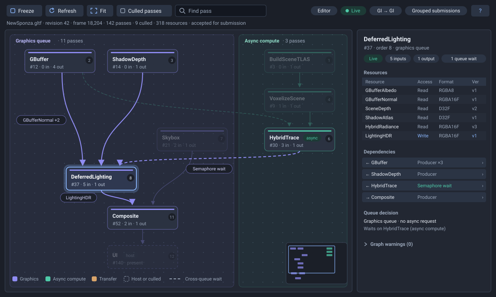
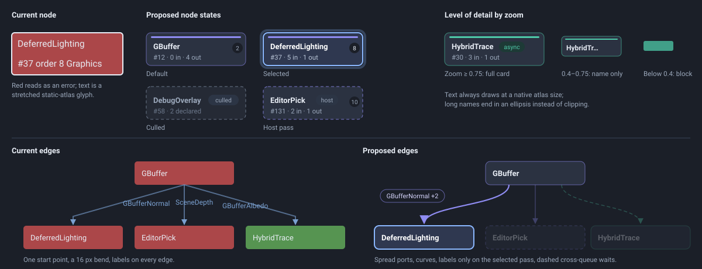

# ZenEditor Render Graph Viewer Styling

Suggestions for making the **Render Graph** window easier to read and closer to
the editor's visual language. They apply to the top-to-bottom canvas in
[RenderGraphView.cpp](../ZenEditor/ImGui/Source/RenderGraphView.cpp) and
[RenderGraphLayout.cpp](../ZenEditor/ImGui/Source/RenderGraphLayout.cpp), as
introduced by the [viewer plan](ZenEditorRenderGraphViewerPlan.md).

Status: implemented. Capture and refresh policy are unchanged. The native window
now honours the editor's explicit UI scale and redraws while a navigation
animation is active, then returns to its existing on-demand behaviour.

Implementation notes:

- Canvas drawing lives in `RenderGraphCanvas.cpp`; shared colours and dimensions
  live in `RenderGraphStyle`. Titles use the editor's existing Roboto Medium face
  baked at 13 px, with a second 11 px font for details, both multiplied by UI scale.
  Neither font is stretched with graph zoom.
- Compact toolbars put filters and Trace in **View**, and retain status detail in
  chip tooltips when all chips cannot fit. Resource names use ellipses with full
  metadata on hover.
- Full layout/Fit runs four alternating sweeps and parent-median alignment.
  Native New Sponza inspection exposed excessive width from parallel passes and
  dummy nodes: independent passes now wrap at four cards per lane per row, and
  routing points reserve 12 px instead of a full card. Incremental captures keep
  valid retained positions.
- Edge-label placement reserves cards, lane headers, the minimap and other labels.
  If no free space exists, the label is omitted; the edge tooltip still lists all
  reasons. This avoids overlaps even in dense graphs.
- Host filtering and group captions infer the existing pass names. Collapsible
  groups remain deferred as specified below.

Follow-up fixes after comparing native captures with the mockup (31 October 2026):

- **Long edges** take one vertical channel beside the cards between their ends, or a
  single curve when that curve clears every card, instead of stepping sideways at
  each layer. Channel searches use sorted, merged occupied intervals per lane/row
  and jump past blocked ranges. Routing points only seed the ordering sweeps;
  there is no separate nearest-free search before channel assignment.
- **Unrelated edges** recede to 12% alpha and 1 px while a pass is focused; cards
  keep 32%. Labels also avoid the focused curves and try slots above and below flat
  curves.
- **Card detail** depends on whether the fixed-size text fits the card on screen,
  not on a zoom threshold, so Fit views around 70% keep the detail line.
- **Layout and camera stability:** each capture runs one layout update. Small
  changes retain valid positions; when more than half of the passes are new or
  gone (the first frame's environment bake, a mode switch), that update rebuilds
  compactly. Until the user pans or zooms, auto-fit expands the view only when new
  work outgrows it. Removing temporary work keeps the camera steady; explicit Fit
  or resizing fits the current bounds again. After manual navigation, resizing
  preserves zoom and the graph point at the canvas centre.
- **Overview grid:** dots below 3% opacity are omitted. Visible grid spacing stays
  at least 24 logical screen pixels by skipping alternate rows and columns.
- **Glyphs:** Roboto Medium has no U+2190/U+2192 arrows, so dependency rows draw
  their arrows and chevrons. The legend, chips and inspector header follow the
  mockup.
- **Captures:** `--capture-graph=path.ppm --frames=N [--graph-select=Pass]` writes
  the window for comparisons like these (see `ZenEditor/README.md`). A declined
  final presentation retains the capture request and continues the loop until a
  frame is accepted, or the existing consecutive-decline limit closes the viewer.

Routing refinement measurement (Windows MSVC Debug, same deterministic 128-pass,
648-edge workload, three fresh layouts): 673–681 ms before, 41–43 ms after.
`RenderGraphLayout.DISABLED_DenseRoutingBenchmark` is an opt-in timing probe;
regular tests check card/channel clearance, incremental auto-fit stability,
resize after pan/zoom, and overview draw-list size without timing assertions.
Native capture retry tests cover inline and threaded Vulkan, including the
consecutive-decline limit. These synthetic timings are not measurements of a
particular scene capture.

## Expected result

The mockup uses the editor theme (`WindowBg` `#1b1f28`, `ChildBg` `#222732`,
`Border` `#3a4557`, brand `#8bb8ff`). The window has three areas:

- **Header:** one toolbar row (Freeze, Refresh, Fit, Culled passes, Find pass)
  with status chips on the right, and one muted line holding the scene, revision,
  frame and graph statistics.
- **Canvas:** a dot grid; tinted lanes for each queue with a header and pass
  count; card nodes; curved edges. Selecting `DeferredLighting` highlights it and
  its direct neighbours, dims unrelated work, and labels only that pass's edges.
  A minimap and a legend sit in the bottom corners.
- **Inspector:** the pass name with chips, a resource table, clickable
  dependency rows, the queue decision and a collapsed warnings section.

## Constraints

- **Fonts:** the UI uses a static font atlas (`ZenUI/ImGui/Include/ImGui/ImGuiConfig.h`
  does not advertise `RendererHasTextures`). Any text drawn at a size other than
  the baked one is a stretched bitmap.
- **Drawing:** everything is drawn with `ImDrawList` through the existing
  ImGui → UIRenderer → VulkanRHI path. No new shader, font loader or node-editor
  library.
- **Redraw:** the window redraws only on changes and settle frames. Animations
  must request settle frames while they run and stop afterwards.
- **Layout stability:** incremental captures keep retained positions; heavier
  layout passes run only on Fit or a full rebuild.
- **Code style:** the project C++ rules apply (single return, explicit types,
  `HeapVector`, `.clang-format`).

## Palette and sizes

Put these in one `RenderGraphStyle` struct next to the view, instead of
borrowing `EditorPalette::axis`, whose red reads as an error.

| Role | Value | Notes |
| --- | --- | --- |
| Graphics pass | `#8f8cf2` | Accent rule, lane tint, edges |
| Async compute pass | `#4ec9a8` | Accent rule, lane tint, `async` chip |
| Transfer pass | `#d9a46a` | Muted gold, kept apart from the warning amber |
| Culled pass | `#6b778a` | Dashed outline, no accent rule |
| Node body | `#2b3241` | One step above the canvas (`#222732`) |
| Selected body and outline | `#2f3850`, `#8bb8ff` | 2 px outline plus a 25% halo |
| Secondary text | `#9ba8bb` | Detail line, lane counts, legend |
| Edge label pill | fill `#1b1f28`, outline at 60% of the edge colour | Rounded |
| Dimmed content | 32% alpha | Applied to unrelated nodes and edges |

| Size | Value at zoom 1 |
| --- | --- |
| Node | 170 × 56, corner radius 8 |
| Accent rule | 3 px, inset 8 px from the node's sides and 6 px from its top |
| Order badge | radius 9, top-right corner |
| Layer and column gaps | 39 and 30 (node pitch 95 and 200) |
| Edge width | 2.2 highlighted, 1.4 normal |

Scale corner radius, outline width and arrowheads with zoom (clamped), so
nodes keep their proportions when zoomed out.

## First tier: canvas drawing

These changes stay inside `DrawCanvas` and the style struct. They don't touch
layout logic or its tests.

### 1. Native-size text with levels of detail

**Problem.** `AddText(nullptr, GetFontSize() * m_zoom, ...)` stretches the
static-atlas glyphs, so labels are blurry above zoom 1 and break up below it.

**Change.**
- Draw text at the atlas size and choose content by zoom:
  - **zoom ≥ 0.75:** title, detail line, chips and order badge;
  - **0.4–0.75:** title only, shortened to fit;
  - **below 0.4:** a coloured block with no text.
- Shorten names that overflow with "…" (measure with `CalcTextSize`) instead of
  clipping them.
- If two text sizes are needed, add a second, smaller font to the atlas at
  `UIContext::Init` time and pick the nearer one; still never scale.

**Done when** labels are pixel-sharp at every zoom and no text is clipped
mid-glyph.

### 2. Card nodes and a dedicated palette

**Problem.** Every node is filled with gizmo axis colours at 70% alpha, so
graphics passes are red, white text contrasts poorly, and states (selected,
culled, host) look alike.

**Change.**
- **Default:** a `#2b3241` body; a 1 px outline in the queue colour at 60%;
  a 3 px accent rule; the title (13 px, bold); a muted detail line
  (`#id · N in · M out`); and an execution-order badge.
- **Chips** go next to the title: `async` when async compute was requested,
  `host` for editor and Play host passes (UI, pick, bounds, mesh preview,
  compositor), and `culled` for culled passes.
- **Selected:** a brighter body, a 2 px brand outline and a soft halo.
- **Culled and host:** dashed outlines (draw dashes as short `AddLine`
  segments); culled passes also drop the accent rule.

**Done when** a pass's queue, type, state and order can be read without opening
the inspector.

### 3. Curved edges from spread ports

**Problem.** A straight segment plus a 16 px bend leaves every node from the
same point. Long edges cut diagonally across the graph, and arrowheads are
fixed screen triangles that ignore the edge direction.

**Change.**
- **Curves:** draw `AddBezierCubic` from the source's bottom edge to the
  destination's top edge, with both control points placed vertically at half
  the vertical distance.
- **Ports:** spread a node's outgoing ports across its bottom edge, ordered by
  each destination's x, and incoming ports across its top edge, ordered by each
  source's x.
- **Arrowheads:** orient along the curve's final tangent and scale with zoom,
  clamped.
- **Hit testing:** flatten the curve into about 12 segments for hover, reusing
  `LineDistance`.

**Done when** no edge leaves through a node's side, and edges that share an
endpoint start from separate points.

### 4. Focus on the selection

**Problem.** In a graph of more than 100 passes, the selected pass's
connections are hard to follow.

**Change.**
- Draw the selected pass and its direct neighbours at full alpha.
- Draw their edges at the highlighted width.
- Dim everything else to 32%.
- Add an optional *Trace* toggle that extends the highlight to all upstream and
  downstream passes. Walk the edge list once per selection change and cache the
  result.
- Hovering a node previews the same highlight without changing the selection.

**Done when** selecting a pass makes its inputs and outputs readable at a
glance in the New Sponza graph.

### 5. Edge labels only where they help

**Problem.** Above zoom 0.65 every edge gets its first resource name at the
midpoint, so labels pile up on top of each other and on the lines.

**Change.**
- Label only the selected or hovered pass's edges.
- Draw each label as a rounded pill beside the curve, not on it.
- When an edge carries several reasons, show the first resource and `+N`
  (for example `GBufferNormal +2`).
- Name cross-queue edges after the wait (`Semaphore wait`).
- The tooltip keeps the full list of reasons.

**Done when** labels never overlap each other at any zoom.

## Second tier: layout quality

These changes belong to `RenderGraphLayout::Update`. Run them only for a new
scene, Fit or a rebuild, so retained positions stay stable between captures.

### 6. Fewer edge crossings

Passes are currently placed in the first free slot of their layer. After
layering, run 2–4 alternating sweeps, down then up, that reorder each layer by
the average position of each pass's neighbours (the barycenter step of the
Sugiyama layered layout). Then assign x by pulling each pass toward the median
x of its parents, keeping the minimum spacing. Add a `RenderGraphLayout` test
that counts crossings on a fixed graph and expects fewer after the sweeps.

### 7. Long edges that avoid nodes

An edge that skips layers can pass through nodes in between. Insert one
invisible point per skipped layer (the usual dummy-node technique), include
these points in the ordering sweeps, and draw the edge as a smooth curve
through them.

### 8. Queue lanes and cross-queue waits

Draw each lane as a lightly tinted band with a rounded border. Keep its header
(queue name and pass count) pinned to the top edge of the canvas while
panning. Draw edges between queues dashed, in the colour of the queue that
waits: they are the synchronisation points async-compute work most needs to
show.

## Third tier: window chrome and polish

### 9. Quieter background

Replace the full line grid with dots every 24 units at low contrast (or faint
lines with a stronger line every fifth step), and fade it out below zoom 0.4.

### 10. Compact header

- Merge the four status lines into the toolbar row and one muted line.
- Show source (Editor/Play), state (Live, Frozen, Stale in warning amber),
  algorithm and submission mode as chips.
- Move the build generation into the chip tooltip.
- Use the editor's icon buttons (`EditorToolButton`) for Freeze, Refresh and
  Fit.
- Replace the inspector's colour legend text with a `?` popup.

### 11. Inspector tables and links

- List the selected pass's accesses in `ImGui::BeginTable` with columns
  Resource, Access, Format, Version, alternating row backgrounds, and writes in
  the brand colour.
- Print formats by name (`RGBA16F`, `D32F`) instead of `format %u`.
- Make each dependency row clickable: it selects and centres the other pass,
  and the row shows its direction (← input, → output) and reason.
- Add a short *Queue decision* section, and collapse *Graph warnings* with a
  count.

### 12. Minimap and smooth navigation

- **Minimap:** in the canvas's bottom-right corner, draw passes as small
  queue-coloured bars and the viewport as a brand-coloured outline. Clicking
  or dragging on it moves the view.
- **Animated navigation:** Fit and Find pass animate pan and zoom over about
  150 ms with an ease-out curve. Keep requesting settle frames until the
  animation ends.

### 13. Grouping

- **Group frames:** draw a faint rounded frame behind passes that share a name
  prefix (`Hybrid`, `Voxel`, `Shadow`), with the prefix as its caption.
- **Hide host passes:** add a toggle that hides UI, pick, bounds, mesh preview
  and compositor passes.
- **Collapsible groups** would need a pass category or debug scope recorded by
  RDG; leave that for a later change.

## Suggested order

1. Style struct, nodes and native-size text (1, 2).
2. Curved edges, ports and arrowheads (3).
3. Selection focus and edge labels (4, 5).
4. Header and inspector (10, 11), then the grid (9).
5. Crossing reduction and dummy nodes (6, 7), with the crossing-count test.
6. Lanes, minimap, animation and grouping (8, 12, 13).

Steps 1–3 can land without layout changes and give most of the visible
improvement.

## Validation

- **Captures:** capture the window natively at 100% and 200% UI scale on the
  New Sponza graph, both in PBR and Voxel GI. Store them next to these mockups
  for comparison.
- **Text:** check that text is sharp at zoom 0.5, 1 and 2, and that no label
  overlaps another with a pass selected.
- **Crossings:** compare edge-crossing counts before and after items 6–7 on the
  same capture.
- **Redraw cost:** the window must still draw nothing while idle. Animations
  stop requesting frames when they finish, and Vulkan validation stays clean.
